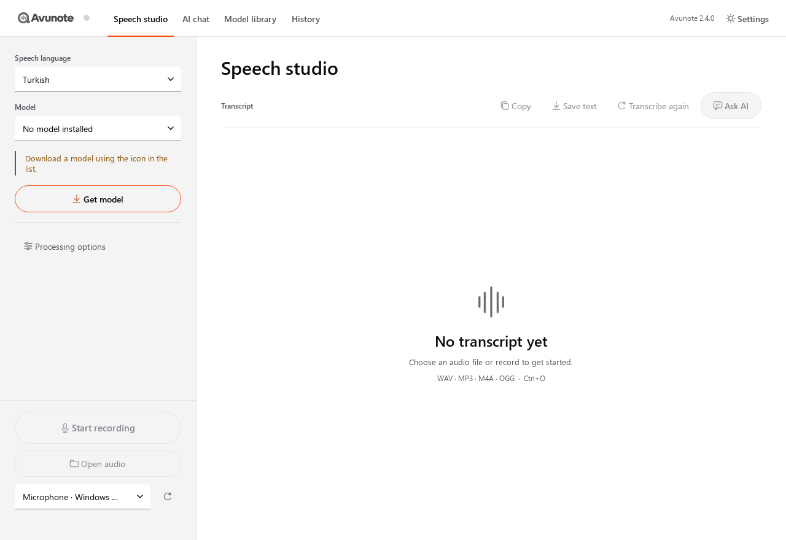
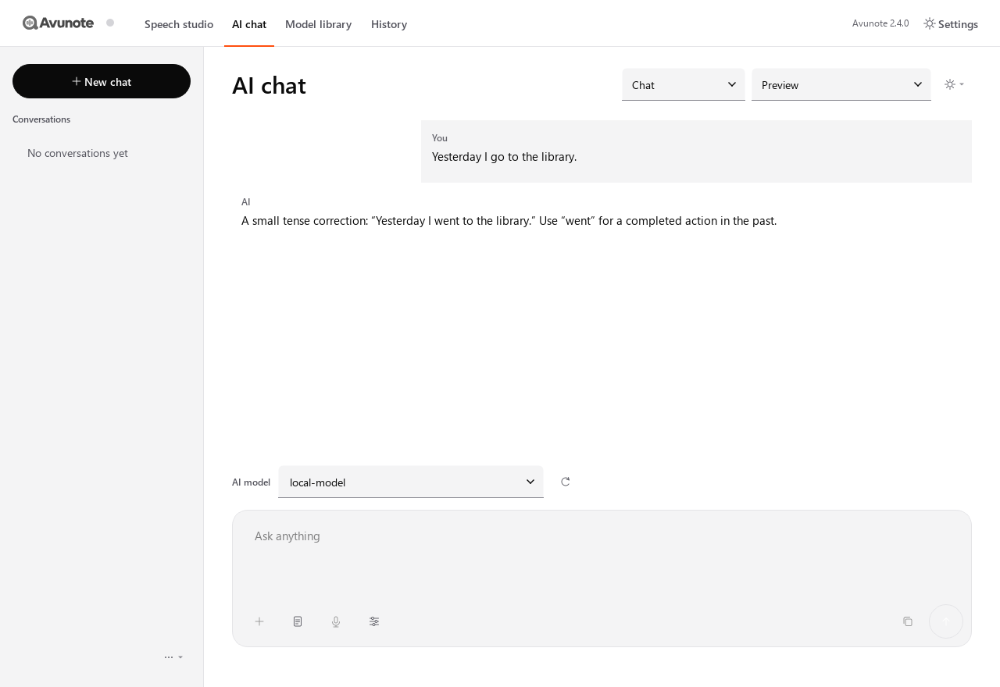

# Avunote


برنامهٔ دسکتاپ تبدیل گفتار به متن برای **Windows 10/11 x64**، توسعه‌یافته توسط **Fardin Milani**. ضبط کنید یا فایل صوتی بیندازید؛ زبان و مدل را انتخاب کنید. تشخیص روی همین دستگاه می‌ماند.

[English](README.md) · [GitHub](https://github.com/Fardinmilani/Voxriva) · [fardinmilani.ir](https://fardinmilani.ir)

نسخهٔ **۲٫۴٫۰**. نام محصول Avunote (آوونوت) است. نشانی مخزن گیت‌هاب همچنان `Fardinmilani/Voxriva` است؛ نام قبلی برنامه Voxriva بود. بستهٔ سورس و نسخهٔ منتشرشده وزن مدل و فایل صوتی شخصی همراه ندارند.





## این برنامه چیست

Avunote یک استودیوی دسکتاپ است: ضبط میکروفون یا فایل WAV/MP3/M4A/OGG، کتابخانهٔ مدل تشخیص گفتار محلی، تاریخچهٔ متن‌ها، و گفت‌وگوی اختیاری با AI دربارهٔ همان متن‌ها. صوت برای تشخیص آپلود نمی‌شود. اینترنت برای دانلود مدلی که خودتان انتخاب می‌کنید، بررسی به‌روزرسانی از GitHub Releases (فقط نصب Setup)، و — فقط پس از زدن Send روی اتصال راه دور — ارسال **متن** به API هوش مصنوعی استفاده می‌شود.

رابط به‌صورت پیش‌فرض انگلیسی باز می‌شود. زبان منوها و زبان گفتار مستقل‌اند؛ عوض کردن رابط، خروجی تشخیص را ترجمه نمی‌کند. اطلاعات توسعه‌دهنده در About است. صفحات اصلی: استودیو، تاریخچه، کتابخانهٔ مدل‌ها، گفت‌وگوی AI و تنظیمات.

## امکانات

### استودیوی گفتار

- زبان گفتار را انتخاب کنید؛ فهرست مدل‌ها بر همان زبان فیلتر می‌شود.
- از میکروفون انتخاب‌شده ضبط کنید، یا فایل WAV، MP3، M4A یا OGG را انتخاب / داخل پنجره رها کنید.
- با پایان ضبط یا ارسال فایل، تبدیل شروع می‌شود.
- خروجی، متن خام مدل است؛ ترجمه، اصلاح املا و بازنویسی خودکار روی متن اصلی انجام نمی‌شود.
- کپی، ذخیرهٔ متن، و تبدیل دوبارهٔ همان فایل با زبان یا مدل دیگر.
- گزینه‌های پردازش: دقت بیشتر یا سریع‌تر؛ Automatic / CPU / CUDA / NPU؛ طول بخش ۱۰ تا ۳۰ ثانیه (پیش‌فرض ۲۰). فایل بلند ابتدا محلی به PCM16 مونو ۱۶ کیلوهرتز تبدیل می‌شود و در پنجره‌های محدود با ذخیرهٔ میانی هر بخش پردازش می‌گردد. CUDA و NPU به ران‌تایم، درایور و (برای NPU) خروجی محلی OpenVINO سازگار نیاز دارند؛ خطا روی همان بخش روی CPU تکرار می‌شود. نسخهٔ پیش‌فرض PyTorch مخصوص CPU دارد و کتابخانهٔ CUDA را بی‌صدا دانلود نمی‌کند.
- ظاهر روشن، تاریک یا هماهنگ با سیستم. جهت بصری «Signal»: سطح‌های تک‌رنگ و یک رنگ تأکیدی برای ضبط و وضعیت زنده.

### کتابخانهٔ مدل‌ها

مدل‌ها در فهرست دیده می‌شوند تا وقتی دانلود یا از پوشهٔ محلی معرفی شوند. دانلود درصد، سرعت، توقف موقت/ادامه و لغو دارد. اندازه و یکپارچگی فایل با کاتالوگ سنجیده می‌شود؛ فایل ناقص آماده محسوب نمی‌شود. مدل چندزبانه بین زبان‌های پشتیبانی‌شده مشترک است؛ رفتن از فارسی به ترکی یا انگلیسی همان مدل Whisper را دوباره دانلود نمی‌کند.

کاتالوگ ۲٫۴٫۰ (حجم فایل‌های لازم مخزن است، نه RAM یا حجم نصاب):

| مدل | دانلود تقریبی | موتور | توضیح |
|---|---:|---|---|
| Whisper Tiny / Base / Small / Medium | ۷۸ · ۱۴۸ · ۴۸۶ مگابایت · ۱٫۵۳ گیگابایت | faster-whisper | مدل‌های چندزبانهٔ مشترک |
| [Omnilingual ASR 300M](https://huggingface.co/facebook/omniASR-CTC-300M) | ۳۶۵ مگابایت | Sherpa-ONNX CTC | پوشش گسترده با تشخیص خودکار زبان/خط |
| [NVIDIA Parakeet TDT 0.6B v3](https://huggingface.co/nvidia/parakeet-tdt-0.6b-v3) | ۶۷۰ مگابایت | Sherpa-ONNX | تشخیص خودکار میان ۲۵ زبان اروپایی |
| [Alibaba Qwen3-ASR 0.6B](https://huggingface.co/Qwen/Qwen3-ASR-0.6B) | ۹۸۷ مگابایت | Sherpa-ONNX | تشخیص خودکار زبان، شامل فارسی، ترکی و عربی |
| [FunAudioLLM SenseVoice Small](https://huggingface.co/FunAudioLLM/SenseVoiceSmall) | ۲۴۰ مگابایت | Sherpa-ONNX | ماندارین، انگلیسی، ژاپنی، کره‌ای |
| AZB Base Full / Base / Tiny / Small Farsi-init | ۲۹۲ · ۲۹۲ · ۱۵۳ · ۹۶۹ مگابایت | Transformers | مدل اختصاصی آذربایجانی ایران / جنوبی ([Kartal Ol](https://github.com/Kartalol)) |

۹۹ دستهٔ زبان گفتار وجود دارد. مدل عمومی Whisper با کد `az` جایگزین آذربایجانی ایران نشده است. عنوان Farsi-init نقطهٔ شروع آموزش مدل آذربایجانی است، نه مدل فارسی. مدل‌های «تشخیص خودکار» زبان را فقط از میان زبان‌های خودشان حدس می‌زنند. کارت و مجوز را قبل از دانلود در کتابخانه ببینید. درصد دقت برای همهٔ لهجه‌ها تضمین نمی‌شود.

### تاریخچه

نتایج محلی با نام فایل/ضبط، مدت صوت، زمان تبدیل و تاریخ. دوبارکلیک یا «باز کردن متن» متن خام و آمار را برمی‌گرداند. می‌توان پوشهٔ ضبط‌ها و متن‌ها را روی دیسک باز کرد.

### گفت‌وگوی AI

AI از تشخیص گفتار جداست. می‌توانید دربارهٔ متن استودیو حرف بزنید، متن بنویسید، یا داخل گفت‌وگو ویس بگذارید. حالت‌ها: **گفت‌وگو**، **بررسی دستور زبان** (اصلاح با توضیح کوتاه) و **تمرین زبان**. حالت در همان گفت‌وگو ذخیره می‌شود. گفت‌وگوهای ذخیره‌شده بعد از بستن برنامه ادامه می‌یابند.

ویس داخل چت **انتخابگر زبان گفتار و مدل تشخیص جدا** دارد (از جمله تشخیص خودکار اگر مدل پشتیبانی کند). وقتی برنامه بیکار است می‌توان دوباره ضبط کرد یا فایل صوتی دیگری پیوست کرد. تبدیل با همان موتور محلی استودیو انجام می‌شود. متن وارد پیش‌نویس قابل ویرایش می‌شود؛ ارسال فقط با **Send** است. صوت به سرویس AI فرستاده نمی‌شود.

### اتصال‌های API

اتصال را از پیش‌تنظیم‌ها اضافه کنید؛ Avunote مدل زبانی دانلود نمی‌کند. ساخت پروفایل درخواست شبکه نمی‌فرستد. شناسهٔ مدل قابل ویرایش است. فهرست مدل فقط با درخواست شما تازه می‌شود.

| اتصال | روش |
|---|---|
| Google AI Studio / Gemini | `generateContent` (نه Vertex AI) |
| OpenAI | API سازگار با OpenAI |
| Anthropic Claude | Anthropic Messages |
| OpenRouter | ورود مرورگر برای مدل‌های **رایگان**، یا کلید `sk-or-` |
| Groq، Mistral، Together، DeepSeek، Fireworks، xAI | پیش‌تنظیم سازگار با OpenAI |
| OpenAI-compatible سفارشی | نشانی پایه و کلید شما |
| LM Studio محلی | `http://127.0.0.1:1234/v1` |
| Ollama محلی | API محلی؛ مدل باید از قبل روی همان دستگاه نصب شده باشد (نه برچسب cloud-routed) |

ارسال به سرویس راه دور تأیید جدا می‌خواهد. سهمیهٔ رایگان Google AI Studio ثابت یا نامحدود نیست. مدل‌های رایگان OpenRouter محدودیت دارند؛ متن به OpenRouter و سرویس بالادست می‌رود. توقف درخواست پاسخ محلی را کنار می‌گذارد؛ ممکن است سرویس درخواست پذیرفته‌شده را تمام کند. پاسخ AI جدا از متن خام گفتار ذخیره می‌شود و آن را عوض نمی‌کند.

### زبان رابط و راست‌به‌چپ

دوازده زبان رابط: انگلیسی، فارسی، ترکی، عربی، آذربایجانی، اسپانیایی، فرانسوی، آلمانی، پرتغالی برزیل، روسی، چینی ساده‌شده و ژاپنی. فارسی و عربی راست‌به‌چپ‌اند و از قلم Vazirmatn همراه برنامه استفاده می‌کنند.

### حریم خصوصی و کلیدها

- پس از دانلود مدل، تشخیص گفتار محلی است و صوت آپلود نمی‌شود.
- کلید API پیش‌فرض فقط در نشست جاری است؛ ذخیرهٔ اختیاری با DPAPI همان حساب ویندوز. کلید در خروجی گفت‌وگو، لاگ یا این مخزن نیست.
- دادهٔ محلی (مدل، ضبط، متن، چت، کلید رمزشده) در `%LOCALAPPDATA%\AZBVoiceStudio` است؛ این نام پوشه برای ارتقا از نسخه‌های قبل حفظ شده. ترتیب متغیر جایگزین: `AVUNOTE_DATA_DIR`، `VOXRIVA_DATA_DIR`، `AZB_DATA_DIR`.
- پوشهٔ مدل موجود یا `_internal\assets\models` نسخهٔ پرتابل قدیمی را می‌توان معرفی کرد؛ چک‌پوینت سازگار همان‌جا خوانده می‌شود.

جزئیات سخت‌افزار، NPU و حریم AI در [FEATURES_2_2.md](FEATURES_2_2.md) و به‌روزرسانی درون‌برنامه در [docs/UPDATES.md](docs/UPDATES.md). نصب Setup می‌تواند Releases مخزن `Fardinmilani/Voxriva` را بررسی کند؛ `AVUNOTE_DISABLE_UPDATES=1` آن را خاموش می‌کند.

دامنهٔ پیشنهادی **avunote.com** را این پروژه ثبت یا منتشر نکرده است. [docs/BRAND.md](docs/BRAND.md).

## پیش‌نیاز

- ویندوز ۱۰ یا ۱۱، **x64**
- اجازهٔ میکروفون در تنظیمات ویندوز برای ضبط
- فضای دیسک برای مدل‌هایی که دانلود می‌کنید
- اختیاری: اینترنت برای مدل، به‌روزرسانی و AI ابری
- CUDA/NPU فقط با ران‌تایم محلی اضافه؛ دانلود خودکار نیست

## نصب نسخهٔ آماده

1. فایل `Avunote-<version>-Windows-x64-Setup.exe` را از [Releases](https://github.com/Fardinmilani/Voxriva/releases) بگیرید (در صورت نیاز `.sha256.txt` را هم برای بررسی).
2. اگر Avunote یا Voxriva باز است ببندید.
3. Setup را اجرا کنید، مسیر نصب را انتخاب کنید؛ ساخت میان‌بر دسکتاپ در صفحهٔ پایان اختیاری است. نصب پیش‌فرض برای همان کاربر است.
4. برنامه را باز کنید، زبان گفتار را انتخاب کنید، مدل را از کتابخانه بگیرید، سپس ضبط کنید یا فایل باز کنید.

نصاب نصب قبلی را پیدا می‌کند و مدل‌ها، تنظیمات، اتصال‌های AI و تاریخچهٔ محلی را نگه می‌دارد.

به‌جای Setup می‌توان ZIP را استخراج کرد و `Avunote.exe` را اجرا کرد؛ پوشه‌های `app`، `_internal` و مجوزها را کنار فایل اجرایی بگذارید. Python یا Node.js جدا لازم نیست. فایل Setup را در Releases بگذارید، نه داخل گیت.

## اجرای سورس

Python **۳٫۱۱ تا ۳٫۱۳** معماری x64 و محیط مجازی همین پروژه. PowerShell:

```powershell
py -3.13 -m venv .venv
.\.venv\Scripts\python.exe -m pip install --upgrade pip
.\.venv\Scripts\python.exe -m pip install torch==2.8.0 --index-url https://download.pytorch.org/whl/cpu
.\.venv\Scripts\python.exe -m pip install -r requirements.txt
.\.venv\Scripts\python.exe app\entrypoint.py
```

ابتدا چرخ CPU مربوط به PyTorch را نصب کنید تا وابستگی CUDA ناخواسته نیاید. نصب سورس `imageio-ffmpeg` ممکن است FFmpeg عمومی GPL داشته باشد. ساخت قابل‌بازتوزیع باید از FFmpeg سبک LGPL در `vendor/ffmpeg.exe` استفاده کند؛ [THIRD_PARTY_NOTICES.md](THIRD_PARTY_NOTICES.md).

## ساخت و مشارکت

پس از تغییر کد، **`BUILD_SETUP.cmd`** را اجرا کنید. برای انتشار، **`VERSION`** را عوض کنید. اسکریپت تست می‌کند، از سورس فعلی می‌سازد، مجوزها را جمع می‌کند و `release/Avunote-<VERSION>-Windows-x64-Setup.exe` به‌همراه SHA-256 می‌نویسد (و در صورت امکان بستهٔ به‌روزرسانی کوچک‌تر؛ [docs/UPDATES.md](docs/UPDATES.md)). گزارش در `.local/build-logs`. فایل اجرایی قدیمی به‌عنوان خروجی جدید استفاده نمی‌شود.

مسیر ابزارها در `.local/build-settings.json` با کلیدهای `Python`، `QtPath`، `SourceCache` و `Makensis`. فقط بررسی پیش‌نیاز:

```powershell
powershell -NoProfile -ExecutionPolicy Bypass -File scripts/build_setup.ps1 -CheckOnly
```

روی گیت‌هاب: **Actions → Build Windows model-free app → Run workflow**. شماره از `VERSION` خوانده می‌شود؛ Release خودکار منتشر نمی‌شود. مدل، کش، نصاب و دادهٔ شخصی را پوش نکنید.

`requirements-dev.txt` را نصب کنید، دیکودر سبک و منابع متناظر را آماده کنید، سپس `build_windows.ps1` را اجرا کنید. آماده‌سازی مجوز در صورت نبود کش حدود ۸۵ مگابایت سورس کتابخانه و بستهٔ ۲٫۲ مگابایتی Intel می‌گیرد؛ این‌ها وزن مدل ASR نیستند.

## مجوز

سورس برنامه [MIT](LICENSE) است، حق‌نشر ۲۰۲۶ Fardin Sheikh Milani. مجوز مدل‌ها و کتابخانه‌ها جداست. تأیید MIT مدل‌های AZB از طرف نگهدارنده توسط توسعه‌دهنده نقل شده؛ این مخزن ادعا نمی‌کند کارت فعلی Hugging Face فایل MIT دارد. نام Kartal Ol و [اعلان‌های شخص ثالث](THIRD_PARTY_NOTICES.md) حفظ شوند.

Qt/PySide به‌صورت کتابخانهٔ جداگانهٔ LGPL استفاده می‌شود؛ متن مجوز و منابع متناظر در بستهٔ اجرایی می‌مانند.
